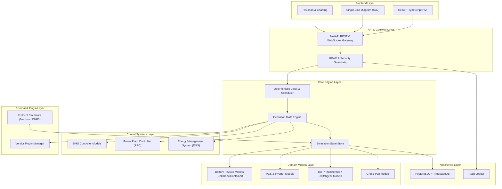

# PowerTwin — Software Architecture Specification

## 1. High-Level Architecture Overview

PowerTwin follows a modular, decoupled, event-and-tick-driven software architecture designed around clean domain separation, strict physical unit standards, deterministic execution, and safe system boundaries.



---

## 2. Component Decomposition

### 2.1 Core Simulation Engine (`backend/engine/`)
- **Responsibility**: Manages the simulation lifecycle, deterministic clock ticks, model execution DAG, state serialization, pause/step/resume commands, and scenario replay.
- **Independence**: Has zero knowledge of HMI components, database drivers, or specific protocol schemas. Communicates via in-memory typed state records.

### 2.2 Equipment Physical Models (`backend/models/`)
- **Responsibility**: Calculates physical state changes per tick using mathematical and electro-thermal equations.
- **Submodules**:
  - `battery/`: Equivalent circuit models (ECM), electrochemical thermal dynamics, SoC/SoH estimation.
  - `pcs/`: Inverter conversion efficiency, AC/DC power coupling, reactive power limits.
  - `bop/`: Transformer impedance, MV/HV switchgear breaker dynamics, HVAC thermal extraction.
  - `grid/`: POI voltage source, grid frequency dynamics, synthetic fault injection.

### 2.3 Control System Stack (`backend/controllers/`)
- **Responsibility**: Implements BESS operational logic across the control hierarchy.
- **Submodules**:
  - `bms/`: Rack and master BMS state machines, voltage/temperature protection limiters, balancing logic.
  - `ppc/`: Active power regulation, Volt-VAR control, ramp rate limiters, grid code compliance functions.
  - `ems/`: High-level economic and operational dispatch engines (peak shaving, arbitrage, frequency response).

### 2.4 Protocol Emulators (`backend/protocols/`)
- **Responsibility**: Translates internal simulation state to industrial communication protocols (Modbus TCP, DNP3, SunSpec) for CIL testing.
- **Boundary Rule**: Disabled by default. Writable registers map to validated command interfaces only.

### 2.5 API Gateway (`backend/api/`)
- **Responsibility**: Exposes secure REST endpoints for scenario management, configuration loading, and control commands; streams telemetry to the HMI via WebSockets.

### 2.6 Persistence & Historian (`backend/db/`)
- **Responsibility**: Stores plant configurations, scenario definitions, audit trails, and high-frequency time-series telemetry using TimescaleDB.

### 2.7 Frontend Web HMI (`frontend/`)
- **Responsibility**: Provides operators with real-time visualization, single-line diagrams (SLD), interactive controls, alarm banners, and historical trends. Built with React and TypeScript.

### 2.8 Plugin System (`plugins/`)
- **Responsibility**: Provides sandboxed interfaces for third-party or vendor-specific equipment models and control strategies.

---

## 3. Core Architectural Invariants

### 3.1 Strict Physical Unit Standard (SI Units)
All internal variable definitions, interface payloads, and calculations **MUST** use explicit SI units:
- Voltage: Volts ($V$)
- Current: Amperes ($A$)
- Power (Active): Watts ($W$)
- Power (Reactive): Volt-Amperes Reactive ($VAR$)
- Energy: Joules ($J$) or Watt-hours ($Wh$)
- Temperature: Degrees Celsius ($^\circ C$) or Kelvin ($K$)
- Resistance: Ohms ($\Omega$)
- Capacitance: Farads ($F$)
- Frequency: Hertz ($Hz$)
- Time: Seconds ($s$) or Integer Ticks ($\mu s$)

### 3.2 State Value Qualification & Explicit Value Types
Every signals and interface object must cleanly distinguish between four distinct values:
1. **Requested Setpoint**: Desired target from operator/EMS.
2. **Accepted Command**: Validated target accepted by PPC/BMS after applying safety limits.
3. **Actual Output**: Physical state generated by PCS/battery dynamics.
4. **Measured Value**: Telemetry value reported by simulated sensors (including noise/accuracy tolerances).

Each measurement payload must adhere to the standard envelope:
```python
class Measurement(BaseModel):
    value: float
    unit: str
    timestamp_ns: int
    quality: QualityFlag  # GOOD, BAD, UNCERTAIN
    source_id: str
```

### 3.3 Configuration-Driven Plant Topology
Plant layouts, equipment counts, container groupings, and transformer specifications are defined entirely via declarative YAML/JSON configuration files validated against Pydantic schemas. Zero plant topologies are hardcoded into model source code.

**The illustrative marker.** Every topology configuration model in `backend/app/topology/schema.py` inherits `IllustrativeConfigModel`, which carries an `illustrative: bool` field. The field **defaults to `True`**, so a parameter set that does not state its status is labelled rather than silently unlabelled — under-labelling is the dangerous direction, and `AGENTS.md` §2.14 requires illustrative parameters to be clearly labelled.

The marker exists at three levels:

| Level | Field | Meaning |
| :--- | :--- | :--- |
| Equipment item | `illustrative` on each container, PCS, transformer, switchgear, auxiliary, meter, POI, grid, controller and grid-service configuration | The parameters of that item are representative values, not validated data |
| Plant | `illustrative` on `PlantTopologyConfig` | The plant contains illustrative parameters |
| Runtime | `EquipmentMetadata.is_illustrative` on every equipment model | The label the configuration gave, carried into the reported equipment state and persisted by the historian |

The plant-level marker is **derived** from the items when the author does not state it, and the schema **refuses** a configuration that declares the plant validated while one of its items is illustrative: that contradiction would under-label the plant, so it is rejected at parse time. The plant factory (`backend/app/topology/factory.py`) passes the marker to every equipment it builds, and both shipped example configurations state it explicitly. `tests/test_illustrative_parameters.py` asserts all of that.
